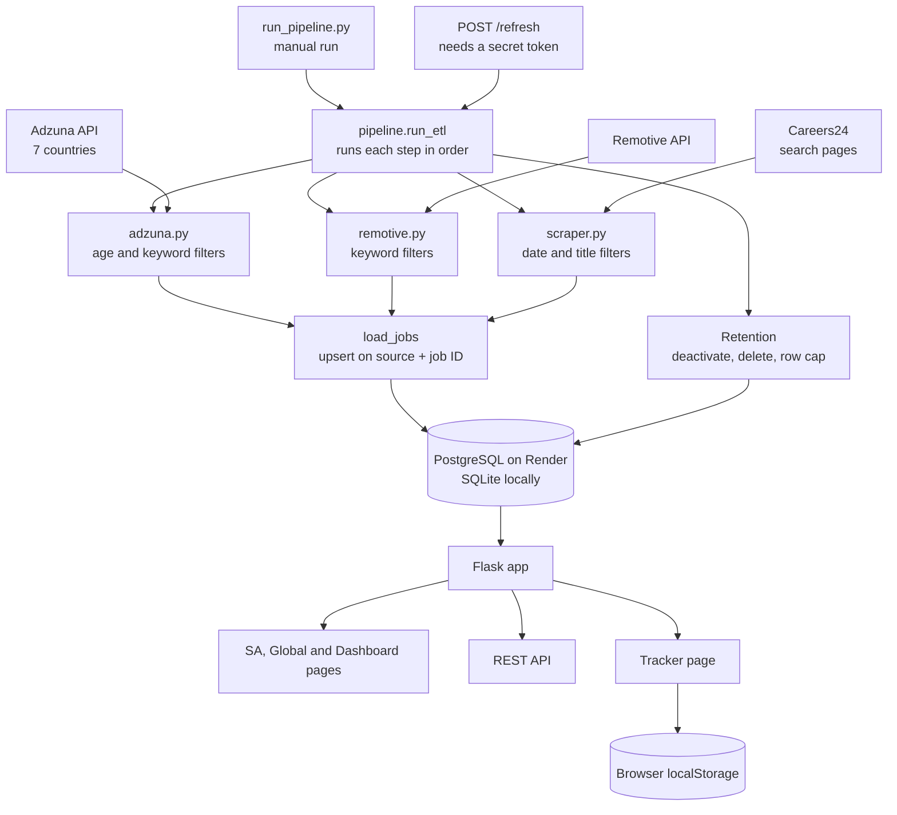

# Entry-Level Job Market Pipeline

[](https://github.com/ntokozo078/entry-job-market-pipeline/actions/workflows/tests.yml)

A Python batch pipeline that collects entry-level tech jobs for South Africa and six other countries. It filters listings by age and seniority keywords, upserts them into PostgreSQL, retires listings that stop appearing, and serves the results through a Flask website and REST API. The site also has a job application tracker that stays in your browser.

The pipeline runs on demand. Nothing in this repo schedules it, and the deployed site's data shows no runs after 22 October 2026.

- [Website](https://entry-job-market-pipeline.onrender.com/)
- [Dashboard](https://entry-job-market-pipeline.onrender.com/stats)
- [REST API](https://entry-job-market-pipeline.onrender.com/api/jobs)

The site is on Render's free tier, so the first request after it has been idle can take up to a minute. On 2 November 2026 it held 102 jobs from its last run on 22 October, all from South Africa through Adzuna. That run predates the fixes described here.

## Data sources

These are real public job listings, not synthetic data.

| Source | Type | Coverage |
|---|---|---|
| [Adzuna](https://www.adzuna.co.za/) | API, needs a key | South Africa, UK, US, Australia, Germany, Netherlands, Canada |
| [Remotive](https://remotive.com/) | API, no key | Remote jobs. It added nothing in the runs below |
| [Careers24](https://www.careers24.com/) | Scraped search pages | South Africa |

The Careers24 scraper is for personal and educational use. It reads 4 search pages per run, identifies itself in its User-Agent, stores only the card details and links back to the original advert. When I checked on 2 November 2026, `robots.txt` didn't block this client and the jobseeker terms didn't mention automated access. That isn't legal clearance, so check the terms yourself before reusing it.

Adzuna's terms ask sites that publish its listings to label and link each advert, which the job cards do. They describe the free key as being for evaluating the API.

## Architecture



## How each stage works

| Stage | What it does |
|---|---|
| **Extract** | Adzuna runs up to 76 search terms for South Africa, with a cap of 100 jobs per run, then 15 terms for each of 6 other countries, capped at 20 jobs per country. Remotive requests 3 categories. The scraper reads the first 15 cards on each of 4 Careers24 pages. If one source raises an error, it's logged and the others continue. |
| **Filter** | **Age:** Adzuna only returns jobs from the last 7 days (South Africa) or 14 days (other countries). Titles naming a year before last year are rejected. **Seniority:** Adzuna and Remotive reject any listing with a senior keyword in its title or description, then require an entry-level keyword. Careers24 only checks the title for "senior" or "lead", because its search page has no description, and it stores "Apply on Careers24" instead. |
| **Load** | Upserts on `(source, source_job_id)`, which has a unique constraint. New jobs are inserted. Existing jobs have their fields overwritten and `last_seen_at` updated, while `first_seen_at` stays the same (SCD Type 1). |
| **Retention** | Each run marks a job inactive if its source hasn't returned it for 30 days, or if it was posted over 150 days ago. It deletes jobs posted over 180 days ago and keeps the table at 1,500 rows or fewer by removing the oldest. |
| **Serve** | Flask renders paginated South Africa and Global pages, a Chart.js dashboard and a JSON API. Skill demand is a keyword count over job titles, done in SQL. |
| **Tracker** | A Kanban board at `/tracker`. It's saved in that browser's localStorage, not the database, so it doesn't follow you to another device. |

## Results

These come from two runs on 2 November 2026, one after the other, on a new SQLite database with Python 3.13. Listings change daily, so your numbers will differ.

| Source | Jobs kept, run 1 | Jobs kept, run 2 |
|---|---|---|
| Adzuna South Africa | 100 (hit the cap) | 100 |
| Adzuna US | 20 (hit the cap) | 20 |
| Adzuna Germany | 19 | 19 |
| Adzuna Netherlands | 18 | 18 |
| Adzuna UK | 12 | 12 |
| Adzuna Canada | 11 | 4 |
| Adzuna Australia | 9 | 9 |
| Careers24 | 35 | 35 |
| Remotive | 0 | 0 |
| **Total** | **224** | **217** |

| Database change | Run 1 | Run 2 |
|---|---|---|
| New rows | 224 | 7 |
| Updated rows | 0 | 210 |
| Deactivated or deleted | 0 | 0 |
| Rows after cleanup | 224 | 231 |

Each run took about 5 minutes and made about 150 Adzuna requests. In run 2, Adzuna returned HTTP 503 for 5 Canadian searches. The pipeline logged them and carried on, which is the likely reason Canada dropped to 4.

The dataset also has clear quality gaps, listed under limitations below.

## Design decisions

- **Separate caps for South Africa and other countries.** With one shared cap of 100, South African results used up the whole run, so no other country was ever searched.
- **Use absence as a signal, not proof.** A job can drop out of Adzuna's date-limited search and still be open, so `is_active = false` means "not seen for 30 days", not "closed".
- **Don't deactivate jobs for a source that returned nothing.** An outage or a broken scraper shouldn't hide all of that source's listings.
- **Keep the refresh endpoint closed by default.** Each run spends API quota, so `POST /refresh` needs a token, and with no token configured it rejects every request. The public button is gone.
- **Refuse to start in production without `SECRET_KEY`.** A public default key would be easy to miss otherwise.
- **Use one Postgres driver.** The app rewrites any Postgres URL to use psycopg 3, so the `postgres://` URLs Render provides work with the only driver installed.
- **Check the schema before changing it.** Startup adds the salary columns only if they're missing. A migration tool would be better once the schema changes more often.

## Known limitations and next steps

**Filter quality**
- Keywords match inside longer words: "intern" matches "internal", "lead" matches "leading". Only 163 of the 224 jobs in run 1 had a whole-word entry-level term in the title, and some are off-topic, such as a hospitality recruiter. Next step: match whole words and add a tech-role check.
- Deduplication only uses the source's job ID, and Adzuna can list the same advert under several IDs. In the final table, 89 of the 231 rows repeated the title and company of another row. Next step: also dedupe on normalised title and company.
- Only 4 of the 89 jobs from other countries were tagged remote, so the Global page is mostly on-site roles abroad.

**Sources**
- Remotive added no jobs. Its API returned only 12 unique jobs across the 3 categories when I checked, and 11 had a senior keyword in the title or description.
- The scraper depends on Careers24's page structure, so a redesign would stop it. When a card shows a closing date, that date is stored as `posted_date`. None of the jobs in these runs had a future date, but it's still wrong.
- The Adzuna quota depends on your plan, and 150 requests per run may not fit a free key if run daily.

**Running it**
- There's no scheduler, so the site's data only changes when someone starts a run. Next step: a daily GitHub Actions job that calls `POST /refresh`.
- `/refresh` runs in a background thread and keeps its status in memory, so a restart loses the status and stops a run in progress.
- Render's free tier sleeps when idle, and free Render databases expire.
- Retention keeps jobs for up to 150 days by posting date, but the 30-day rule normally retires them sooner if the pipeline runs regularly.

**Testing**
- The automated tests use SQLite and stored samples, including a hand-written Careers24 page, so they won't catch a change on a real site. PostgreSQL was checked once by hand against a local server, covering schema setup, upserts and all pages.
- Skill counts only read job titles, and each count scans the table because `ILIKE '%term%'` can't use an index.

## Quickstart

You need Python. This was tested on Windows with Python 3.13, using SQLite, so you don't need to set up a database. An [Adzuna key](https://developer.adzuna.com/) is free, and without one the pipeline skips Adzuna and runs the other sources.

```bash
git clone https://github.com/ntokozo078/entry-job-market-pipeline.git
cd entry-job-market-pipeline
python -m venv venv
```

On **Windows (PowerShell)**:

```powershell
venv\Scripts\Activate.ps1
Copy-Item .env.example .env
```

On **macOS/Linux**:

```bash
source venv/bin/activate
cp .env.example .env
```

Add your Adzuna keys to `.env`, then install and run the pipeline. A full run takes about 5 minutes.

```bash
pip install -r requirements.txt
python run_pipeline.py
```

Start the site at `http://localhost:5000`:

```bash
python run.py
```

Run the tests, which need no keys or network:

```bash
pip install -r requirements-dev.txt
python -m pytest
```

Render starts the app with `gunicorn run:app`, as set in the `Procfile`. Gunicorn doesn't run on Windows, so use `python run.py` there. On Render, set `SECRET_KEY` and `DATABASE_URL`, plus the Adzuna keys and `REFRESH_TOKEN` if you want to start runs there.

## API reference

| Endpoint | Method | Description |
|---|---|---|
| `/api/jobs` | GET | Active jobs, newest first. Optional parameters: `type` (title keyword), `location`, `source`, `limit` (default 50, maximum 200) |
| `/api/stats` | GET | Total and active counts, and rows per source |
| `/api/health` | GET | 200 if the database is reachable, otherwise 503 |
| `/refresh` | POST | Starts a run. Needs an `X-Refresh-Token` header. Returns 202, 403 for a bad token, or 409 if one is already running |
| `/refresh/status` | GET | State of a run started through `/refresh` on this server process |

```bash
curl "https://entry-job-market-pipeline.onrender.com/api/jobs?type=python&location=johannesburg"
```

## Project layout

```text
run.py                  Web entry point
run_pipeline.py         Runs the pipeline once
app/
  __init__.py           App factory and schema setup
  config.py             Settings from the environment
  models.py             Job table
  api/routes.py         REST API
  web/routes.py         Pages and /refresh
  templates/            HTML pages, including the tracker
ingestion/
  pipeline.py           Load and retention steps
  utils.py              Date and title helpers
  extractors/           Adzuna, Remotive and Careers24
tests/                  Pytest suite and stored samples
```

---

**Ntokozo Ntombela** · Graduate Data Engineer · Microsoft Certified: Fabric Data Engineer Associate (DP-700)
[LinkedIn](https://www.linkedin.com/in/ntokozo-ntombela-ba662235a) · [Portfolio](https://data-engineering-portfolio-xi.vercel.app/)
